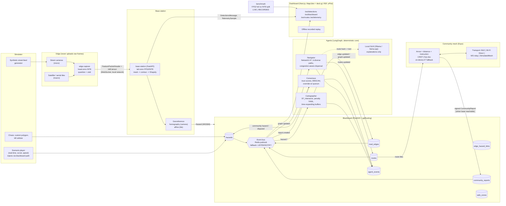

# ARCO Architecture

ARCO (Autonomous Relief Corridor Orchestrator) turns two visual streams into geospatial
hazard polygons, severs or penalises road-graph edges on a shared PostGIS blackboard, and
recomputes crowd-dispersing evacuation routes with a deterministic multi-agent system. A
peer-to-peer community mesh keeps phones routed when cellular is down.

> Everything in the demo is **simulated on real event geometry**. Hazard polygons are
> digitised approximations of public damage surveys; they are not a replay of real
> inference output. Each scenario file states its sources (see `data/scenarios/*.json`).

## Data flow



## Contracts

`packages/shared-schemas` is the single source of truth:

```
Pydantic models (python/arco_schemas/*.py)
   └─ make schemas ─> schema/arco.schema.json (+ models/*.json, hazard_classes.json)
                        └─ json-schema-to-typescript ─> ts/src/generated/arco.ts
```

- Every WebSocket message is discriminated by `type` and carries `scenario_t` (scenario
  clock, the ordering authority), `wall_t` and `seq`.
- `BusEnvelope` wraps the same messages on Redis / NOTIFY, so services and the dashboard
  share one vocabulary.
- `TelemetrySample.mode` and `BenchmarkResult.mode` are required (`live` | `recorded`);
  the UI badge is derived from them and cannot be omitted.
- `Scenario.label` is the literal `"Simulated on real event geometry"`.
- `make schemas-check` fails CI if a model changed without regenerating.

## Services (ports from `.env.example`)

| Service        | Port | Role                                                              |
|----------------|------|-------------------------------------------------------------------|
| postgres       | 5432 | PostGIS 3.5 + pgRouting 3.8 (image `pgrouting/pgrouting:16-3.5-3.8`) |
| redis          | 6379 | Pub/sub for blackboard events (optional)                          |
| blackboard     | 8001 | Spatial REST + `/ws/blackboard`; owns migrations                   |
| base-station   | 8002 | Tail inference, georef, `/ws/detections`, `/ws/telemetry`          |
| agents         | 8003 | Cartographer / Navigator / Consensus, `/ws/routes`                 |
| simulator      | 8004 | Scenario clock, hazard injection, chaos                            |
| benchmark      | 8005 | FP32-vs-split results + `/ws/telemetry` (LIVE run or RECORDED replay) |
| dashboard      | 3000 | Next.js UI                                                         |

## Phase status

| Phase | Scope                                   | Status      |
|-------|-----------------------------------------|-------------|
| 1     | Scaffold, schemas, compose, migrations, CI | **done** |
| 2     | Blackboard tables, events, API, OSMnx   | **done** (see "Blackboard internals") |
| 3     | Cartographer + Navigator (deterministic), SLM behind an interface | **done** (see "Agents internals") |
| 4     | Split-inference vision: ONNX split + INT8 head, edge-capture, base-station (georef, telemetry, synthetic fallback) | **done** (see "Vision internals") |
| 5     | Benchmark harness: A vs B on identical frames, JSON/CSV, hardware from the machine, recorded replay | **built, in review** (see "Benchmark internals") |
| 6-10  | see `PROJECT_SPEC.md` §8                | pending     |

## Blackboard internals (Phase 2)

- **Tables** (`alembic/versions/0002_tables.py`): `hazards`, `road_edges`,
  `edge_hazard_links`, `community_reports`, `safe_zones`, `routes`, `agent_events`, plus
  `graph_state` (single-row `version`) and `bus_outbox`. GiST indexes on every geometry
  column; `routes.path` and `safe_zones.geom` included.
- **Write + event atomically.** `BlackboardService` performs each row change and
  `Publisher.publish()` in one transaction: `seq = nextval(bus_outbox_id_seq)`, row into
  `bus_outbox`, `pg_notify('blackboard_events', seq)`. After commit the same
  `BusEnvelope` is mirrored to Redis `blackboard.<topic>`. Redis is optional; without it
  subscribers `LISTEN` and hydrate the envelope from the outbox by id.
- **Catch-up.** `seq` == outbox id, monotonic. `GET /events?since_seq` and
  `/ws/blackboard?since_seq` replay from the outbox before going live, de-duplicated by
  `seq`.
- **Spatial queries.** bbox filters use `geom && ST_MakeEnvelope(..., 4326)`;
  `edges_intersecting(geom)` returns `EdgeOverlap{edge_id, overlap_fraction}` where the
  fraction is `ST_Length(ST_Intersection)::geography / ST_Length(edge)::geography` (metres,
  not degrees); `reports_near` uses geography `ST_DWithin`.
- **Graph version.** Bumped whenever `road_edges` state changes (`update_edge_states`) or
  the graph is reloaded; `graph.updated` carries `changed_edge_ids` or
  `full_rebuild=true`.
- **Ingestion.** OSMnx MultiDiGraph → one row per directed `(u, v, key)` edge;
  `base_cost = length_m / speed_m_s[highway]`, `capacity_estimate` by highway class, both
  from `services/blackboard/config/ingest.yaml`. The committed Lahaina sample
  (`data/samples/osm/lahaina_drive.graphml`, OSM/ODbL, 266 nodes / 637 edges) makes
  tests and the demo offline.

## Agents internals (Phase 3)

- **Event-driven LangGraph pipeline** (`arco_agents.pipeline`): one `StateGraph` run per
  `BusEnvelope`; `route` → `cartographer` (hazard topics) → `navigator` (graph/edge
  topics). Each node is wrapped so an exception is logged + recorded in
  `recent_errors` and never stops the consumer; graph versions already routed are skipped.
- **Cartographer** = policy, not model: `config/penalties.yaml` is keyed by
  `HazardClass` with the math in comments. Per overlap `w = f·c`; ignore below
  `min_confidence`; sever when `f ≥ sever_fraction ∧ c ≥ sever_confidence`; else
  `current_cost = base_cost·(1 + (max_multiplier−1)·w·(0.5+0.5·s))`; `crowd_bottleneck`
  scales capacity by `capacity_factor^w`. Several hazards on one edge: any-sever / MAX
  multiplier / MIN capacity, recomputed from `edge_hazard_links` on apply, release, TTL
  expiry and buffer regrow. Expanding hazards are buffered
  `min(max_buffer_m, base_margin_m + v·(horizon_s+elapsed_s))` in a metric (AEQD)
  projection before `edges_intersecting`.
- **Blackboard contract additions** (schema 0.2.1, migration `0003`):
  `RoadEdge.capacity_factor ∈ (0,1]`; `BlackboardService.apply_edge_updates(...,
  capacity_factors=)`, `links_for_hazard()`, `links_for_edges()`.
- **Navigator**: NetworkX mirror of `road_edges` (severed removed; parallel edges keep
  the cheapest), incremental on `edge.updated`; A* (haversine / heuristic speed); k
  diverse paths by penalized successive shortest paths; **crowd dispersal** is a
  Frank–Wolfe path-based assignment with BPR edge congestion `cost·(1+α(load/cap)^β)`
  plus a zone-capacity term, then `split_groups` into integer crowd groups (one `Route`
  per group). `compute_ms` is measured with `perf_counter`, never estimated; routes
  carry `graph_version`; edge loads are written back for the dashboard.
- **Explanations**: `Explainer` protocol. `DeterministicExplainer` builds the instruction
  from road names/bearings; `SlmExplainer` (Ollama) is used only when
  `ARCO_SLM_ENABLED=true` and falls back to the template on timeout, error, or if the
  text drops a road name; `CachedExplainer` keys on a route hash so unchanged routes
  cost nothing. `explanation_source` on each `Route` says which produced the text.
- **Runtime** (`arco_agents.runner`): subscribes to `hazard|graph|edge|clock`, ticks
  every `ARCO_AGENTS_TICK_S` (TTL expiry + regrow of hazards whose buffer still grows),
  loads population/safe zones from `ARCO_POPULATION_PATH` or `POST /navigator/population`.
  API on :8003 (`/health` reports graph version, routes, `last_compute_ms`, errors;
  `/ws/routes` streams `routes.updated` + `agent.event`).
- **Test isolation**: suites run in `<db>_test` with Redis channel prefix
  `blackboard-test.` (Redis Pub/Sub is server-wide, so a prefix — not the logical DB
  index — is what isolates the live `agents` container from test events).
- Measured on the dev machine (Lahaina sample, 266 nodes / 637 edges, 6 cells / 2 zones,
  CPU under Colima): cartographer apply ≈ 30–230 ms (cold), navigator full reroute
  ≈ 15–18 ms compute / ≈ 60–270 ms hazard-POST → routes-on-WS wall. These are local
  numbers, not benchmark claims.

## Vision internals (Phase 4)

- **Model-agnostic split** (`arco_edge.onnx_tools`): a cut point is any tensor that is
  the *single* edge between two halves of the ONNX graph **after the last node that reads
  the image input** — that second condition is the privacy guard, enforced by analysis,
  so a tail can never require the frame. `onnx.utils.Extractor` produces `head` / `tail`;
  the FP32 split must reproduce the unsplit model to ≤ 1e-4 (tested on a tiny conv net
  with a skip/concat and on the exported model when present).
- **INT8 head**: ORT static QDQ quantisation (MinMax, per-channel int8 weights, uint8
  activations). The export script measures cosine similarity of the INT8 head vs FP32 on
  held-out inputs and writes it to `manifest.json` (`≥ 0.99` required; yolov8n-seg
  measured 0.9998 with noise calibration). The tail stays FP32 — base-station quantisation
  is a Phase 5 benchmark question, not a Phase 4 assumption.
- **Feature packet**: cut tensor → asymmetric uint8 (per-tensor scale/zero-point, error
  ≤ scale/2) → zstd(3) → msgpack `{h: FeaturePacketHeader JSON, p: bytes}`. The header
  carries `source_id`, `frame_id`, `model_id`/`split_layer`, tensor `shape`/`dtype`/`scale`/
  `zero_point`, `georef` (which includes the image size), `head_ms`, `serialize_ms`,
  `captured_wall_t`, `scenario_t` — no pixels, no file names. Letterbox
  parameters are recomputed from `(width, height, imgsz)` on both sides.
- **Edge privacy guard**: `assert_local_destination()` refuses non-private base-station
  hosts unless `ARCO_ALLOW_REMOTE_BASE=1`, and
  `test_no_raw_frame_leaves_the_edge` runs the real node against a recording link and
  asserts no outbound bytes contain any captured image row.
- **Base station**: YOLOv8-seg decode (boxes + 32 mask coefficients × prototypes) → NMS →
  mask → contour → simplified Shapely polygon in original pixels → `class_map.yaml`
  (identity for fine-tuned hazard models; a labelled **COCO proxy** map with `min_count`
  aggregation for pretrained weights) → georef.
- **Georef**: `CameraGeoref` → planar homography solved by normalised DLT (SVD) in local
  metres around the camera, sign-normalised so calibration points have positive
  projective depth; pixels at/above the horizon (`w ≤ 0`) are rejected rather than mapped
  to infinity; reprojection RMS is exposed. `TileGeoref` → GDAL affine. Rings are closed
  and made valid before becoming `Hazard.geometry`.
- **Hazard identity**: `uuid5(NAMESPACE, "source_id:hazard_class")` — a camera seeing the
  same debris pile for 100 frames updates **one** row (re-post when the footprint area
  changes by `ARCO_HAZARD_CHANGE_FRACTION` (5 %) or every `ARCO_HAZARD_REPOST_S`), so the cartographer is not re-triggered per
  frame. `source` is `micro_vision` / `macro_vision` (or `simulated`).
- **Telemetry**: every frame yields a `TelemetrySample(mode="live")` with all nine stages;
  `network = received − captured − head − serialize` (clock skew clamped + counted),
  drops from frame-id gaps, rolling FPS, CPU/RSS; mirrored to Prometheus `/metrics`.
- **Synthetic fallback** (`ARCO_DETECTOR=synthetic`, the compose default): a scripted
  schedule (`config/synthetic.yaml`) emits detections through the same packet / georef /
  writer / telemetry path with `detector="synthetic"` and `source="simulated"`, so the
  rest of the system can be exercised without model files.
- Measured on the dev machine (M1 Pro, CPU EP, yolov8n-seg @ 640, cut after
  `/model.3`): head INT8 ≈ 6 ms, serialize ≈ 3 ms, packet ≈ 131 kB (21× smaller than the
  raw BGR frame), tail FP32 ≈ 61 ms, unsplit FP32 ≈ 66–68 ms. On this CPU the split
  reduces bandwidth and edge load but **not** base-station compute; Phase 5 benchmarks it
  per hardware and reports whichever stage is the bottleneck.

## Benchmark internals (Phase 5)

- **Same frames, same process, same clock.** `arco_benchmark.pipelines.FullPipeline`
  (JPEG q90 encode → decode → unsplit FP32 → postprocess → georef) and `SplitPipeline`
  (INT8 head → `encode` → `decode` → FP32 tail → postprocess → georef) consume the same
  seeded `Frame`s. Both report all nine contract stages; `network` is 0 for both because
  nothing crosses a socket — it is a compute + codec comparison, stated in every run file.
- **Pacing / drops.** `run_pipeline(pace_fps=30)` models an input arriving every 1/30 s
  into a pipeline with no queue: each arrival instant that passes while busy is a dropped
  frame (counted, never processed); a fast pipeline sleeps until the next slot. `pace_fps=None`
  is pure throughput. `fps` is processed frames / measured wall time after warm-up.
- **Verdict rule.** `meets_target = mean_ms ≤ 80 ∧ fps ≥ 30`; when missed,
  `bottleneck_stage` is the slowest mean stage. Nothing rounds in the target's favour.
- **Hardware** is `HardwareInfo` read from the OS (CPU brand via `sysctl` /
  `/proc/cpuinfo`, RAM, cores, the ORT providers the sessions actually ran with; GPU only
  when a GPU provider is active). It travels inside every `BenchmarkResult`.
- **Files.** `results/<run_id>/{run.json, summary.csv, samples.csv}`; `--record` copies
  the run to `services/benchmark/recorded/` (committed). `arco-bench serve` / compose
  `benchmark` (:8005) replays the newest recorded run on `/ws/telemetry` with
  `mode="recorded"`, and `POST /run` streams a live run (`mode="live"`) when model files
  exist — otherwise `409`, never a fake.
- **Result on the dev machine** (M1 Pro, CPU EP, yolov8n-seg, cut after `/model.3`,
  30 fps paced): A 69.2 ms / 9.9 fps, B 68.3 ms / 10.0 fps, both **miss** the target,
  bottleneck = FP32 tail (~57–61 ms) in both; the feature packet (128 kB micro) is
  *larger* than the JPEG (108 kB) at this cut. The split's measurable win on this
  hardware is privacy and edge-offload flexibility, not latency or bandwidth. Details and
  the reasoning in `services/benchmark/README.md`.

## Limitations (honest list, kept current)

- **Dispersal is static.** Frank–Wolfe over k candidate paths with BPR congestion is a
  planning heuristic, not a time-expanded evacuation simulation; overload is flagged
  (`routes.recomputed.overload`), not guaranteed away.
- **No consensus yet.** Until Phase 6 every `hazard.*` event is applied at face value
  (confidence gates only).

- **Simulated footage.** Street feeds are synthetic composites and macro frames are
  static tiles; detections on them come from pretrained or synthetic detectors, not models
  fine-tuned on these events.
- **Approximated polygons.** Scenario hazard polygons are hand-digitised from public
  damage surveys / imagery and are coarse. They are labelled as approximations in each
  scenario's `notes`.
- **Not a replay of real inference.** Scenario playback injects scripted hazards through
  the blackboard path. Real inference only runs when model files are present and
  `ARCO_DETECTOR` selects them.
- **Benchmark numbers are hardware-specific.** The harness reports the machine it ran on;
  recorded runs are labelled `RECORDED`. If the 80 ms / 30 FPS target is missed, the
  bottleneck stage is reported instead of hidden — and on the CPU-only dev machine it
  **is** missed by both pipelines (see "Benchmark internals"); the split is not faster
  there, and its packet is larger than a JPEG at the chosen cut.
- **Benchmark `network` stage is 0.** Both pipelines run in one process; link latency is
  measured by the live base-station telemetry, not by the harness.
- **Mesh transports.** iOS restricts background BLE advertising and does not expose
  Wi-Fi Direct; `BleTransport` / `WifiDirectTransport` are best-effort. The demo uses
  `SimulatedMeshTransport`, which is clearly labelled.
- **SLM is optional.** Route text falls back to deterministic templates when Ollama /
  llama.cpp is unavailable; speculative decoding depends on the runtime supporting it.
- **Current-day OSM geometry.** The Lahaina sample is a present-day OSM snapshot; roads
  may differ from August 2023. Scenario files state this.
- **Local dev runtime.** On this development machine Docker runs under Colima; Compose
  behaviour is identical but GPU passthrough is unavailable, so vision runs on CPU here.
- **COCO proxy detections are not hazard detections.** Until `scripts/finetune.py` has
  been run on hazard data, real-model runs report cars as `vehicle_blockage` and groups
  as `crowd_bottleneck` through a mapping that is labelled as such (`model_id`).
- **INT8 calibration defaults to seeded noise** when no calibration frames are supplied;
  the manifest records this. Accuracy claims need real-frame calibration.
- **`network` stage trusts the clocks.** It is derived from edge and base wall clocks;
  skew is clamped and counted, not corrected. Host→Colima port forwarding adds tens of ms
  that a real LAN would not.
- **Telemetry `pipeline` has no `synthetic` kind** in the contract yet; synthetic runs are
  labelled through `detector` / `source` instead (contract change requested).
