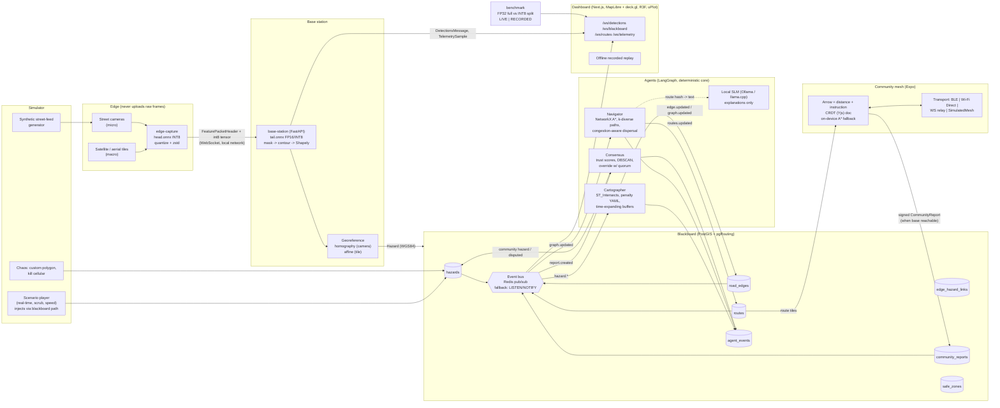

# ARCO Architecture

ARCO (Autonomous Relief Corridor Orchestrator) turns two visual streams into geospatial
hazard polygons, severs or penalises road-graph edges on a shared PostGIS blackboard, and
recomputes crowd-dispersing evacuation routes with a deterministic multi-agent system. A
peer-to-peer community mesh keeps phones routed when cellular is down.

> Everything in the demo is **simulated on real event geometry**. Hazard polygons are
> digitised approximations of public damage surveys; they are not a replay of real
> inference output. Each scenario file states its sources (see `data/scenarios/*.json`).

## Data flow



## Contracts

`packages/shared-schemas` is the single source of truth:

```
Pydantic models (python/arco_schemas/*.py)
   └─ make schemas ─> schema/arco.schema.json (+ models/*.json, hazard_classes.json)
                        └─ json-schema-to-typescript ─> ts/src/generated/arco.ts
```

- Every WebSocket message is discriminated by `type` and carries `scenario_t` (scenario
  clock, the ordering authority), `wall_t` and `seq`.
- `BusEnvelope` wraps the same messages on Redis / NOTIFY, so services and the dashboard
  share one vocabulary.
- `TelemetrySample.mode` and `BenchmarkResult.mode` are required (`live` | `recorded`);
  the UI badge is derived from them and cannot be omitted.
- `Scenario.label` is the literal `"Simulated on real event geometry"`.
- `make schemas-check` fails CI if a model changed without regenerating.

## Services (ports from `.env.example`)

| Service        | Port | Role                                                              |
|----------------|------|-------------------------------------------------------------------|
| postgres       | 5432 | PostGIS 3.5 + pgRouting 3.8 (image `pgrouting/pgrouting:16-3.5-3.8`) |
| redis          | 6379 | Pub/sub for blackboard events (optional)                          |
| blackboard     | 8001 | Spatial REST + `/ws/blackboard`; owns migrations                   |
| base-station   | 8002 | Tail inference, georef, `/ws/detections`, `/ws/telemetry`          |
| agents         | 8003 | Cartographer / Navigator / Consensus, `/ws/routes`                 |
| simulator      | 8004 | Scenario clock, hazard injection, chaos                            |
| dashboard      | 3000 | Next.js UI                                                         |

## Phase status

| Phase | Scope                                   | Status      |
|-------|-----------------------------------------|-------------|
| 1     | Scaffold, schemas, compose, migrations, CI | **done** (this document) |
| 2     | Blackboard tables, events, API, OSMnx   | next        |
| 3-10  | see `PROJECT_SPEC.md` §8                | pending     |

## Limitations (honest list, kept current)

- **Simulated footage.** Street feeds are synthetic composites and macro frames are
  static tiles; detections on them come from pretrained or synthetic detectors, not models
  fine-tuned on these events.
- **Approximated polygons.** Scenario hazard polygons are hand-digitised from public
  damage surveys / imagery and are coarse. They are labelled as approximations in each
  scenario's `notes`.
- **Not a replay of real inference.** Scenario playback injects scripted hazards through
  the blackboard path. Real inference only runs when model files are present and
  `ARCO_DETECTOR` selects them.
- **Benchmark numbers are hardware-specific.** The harness reports the machine it ran on;
  recorded runs are labelled `RECORDED`. If the 80 ms / 30 FPS target is missed, the
  bottleneck stage is reported instead of hidden.
- **Mesh transports.** iOS restricts background BLE advertising and does not expose
  Wi-Fi Direct; `BleTransport` / `WifiDirectTransport` are best-effort. The demo uses
  `SimulatedMeshTransport`, which is clearly labelled.
- **SLM is optional.** Route text falls back to deterministic templates when Ollama /
  llama.cpp is unavailable; speculative decoding depends on the runtime supporting it.
- **Local dev runtime.** On this development machine Docker runs under Colima; Compose
  behaviour is identical but GPU passthrough is unavailable, so vision runs on CPU here.
