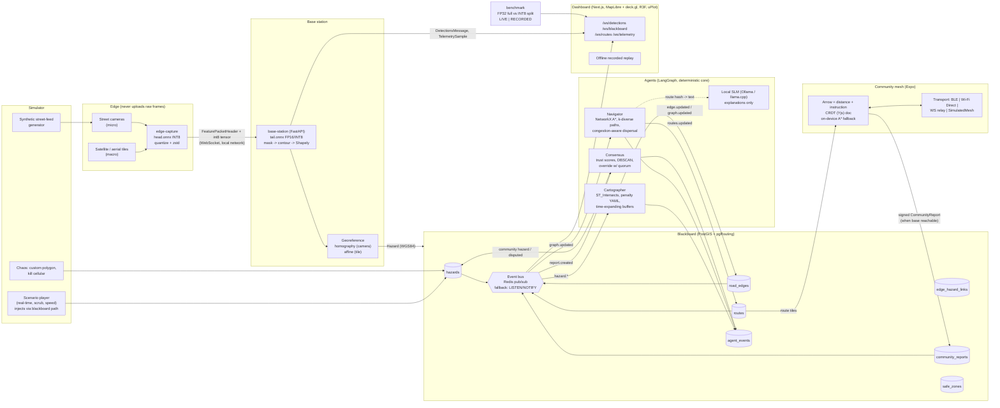

# ARCO Architecture

ARCO (Autonomous Relief Corridor Orchestrator) turns two visual streams into geospatial
hazard polygons, severs or penalises road-graph edges on a shared PostGIS blackboard, and
recomputes crowd-dispersing evacuation routes with a deterministic multi-agent system. A
peer-to-peer community mesh keeps phones routed when cellular is down.

> Everything in the demo is **simulated on real event geometry**. Hazard polygons are
> digitised approximations of public damage surveys; they are not a replay of real
> inference output. Each scenario file states its sources (see `data/scenarios/*.json`).

## Data flow



## Contracts

`packages/shared-schemas` is the single source of truth:

```
Pydantic models (python/arco_schemas/*.py)
   └─ make schemas ─> schema/arco.schema.json (+ models/*.json, hazard_classes.json)
                        └─ json-schema-to-typescript ─> ts/src/generated/arco.ts
```

- Every WebSocket message is discriminated by `type` and carries `scenario_t` (scenario
  clock, the ordering authority), `wall_t` and `seq`.
- `BusEnvelope` wraps the same messages on Redis / NOTIFY, so services and the dashboard
  share one vocabulary.
- `TelemetrySample.mode` and `BenchmarkResult.mode` are required (`live` | `recorded`);
  the UI badge is derived from them and cannot be omitted.
- `Scenario.label` is the literal `"Simulated on real event geometry"`.
- `make schemas-check` fails CI if a model changed without regenerating.

## Services (ports from `.env.example`)

| Service        | Port | Role                                                              |
|----------------|------|-------------------------------------------------------------------|
| postgres       | 5432 | PostGIS 3.5 + pgRouting 3.8 (image `pgrouting/pgrouting:16-3.5-3.8`) |
| redis          | 6379 | Pub/sub for blackboard events (optional)                          |
| blackboard     | 8001 | Spatial REST + `/ws/blackboard`; owns migrations                   |
| base-station   | 8002 | Tail inference, georef, `/ws/detections`, `/ws/telemetry`          |
| agents         | 8003 | Cartographer / Navigator / Consensus, `/ws/routes`                 |
| simulator      | 8004 | Scenario clock, hazard injection, chaos                            |
| benchmark      | 8005 | FP32-vs-split results + `/ws/telemetry` (LIVE run or RECORDED replay) |
| dashboard      | 3000 | Next.js UI                                                         |

## Phase status

| Phase | Scope                                   | Status      |
|-------|-----------------------------------------|-------------|
| 1     | Scaffold, schemas, compose, migrations, CI | **done** |
| 2     | Blackboard tables, events, API, OSMnx   | **done** (see "Blackboard internals") |
| 3     | Cartographer + Navigator (deterministic), SLM behind an interface | **done** (see "Agents internals") |
| 4     | Split-inference vision: ONNX split + INT8 head, edge-capture, base-station (georef, telemetry, synthetic fallback) | **done** (see "Vision internals") |
| 5     | Benchmark harness: A vs B on identical frames, JSON/CSV, hardware from the machine, recorded replay | **done** (see "Benchmark internals") |
| 6     | Consensus agent: signed community reports, trust ledger, ST-DBSCAN, vision-negative override, disputes | **done** (see "Consensus internals") |
| 7     | Simulator: scenario player (clock, seek, chaos), Lahaina / Joplin / Camp Fire scenarios on real OSM geometry, synthetic street feeds | **done** (see "Simulator internals") |
| 8     | Dashboard: MapLibre + deck.gl + three.js, snap animation, telemetry strip, agent reasoning, offline recorded replay | **done** (see "Dashboard internals") |
| 9     | Mobile: Expo arrow UI, signed pins, yjs CRDT mesh over `Transport` seam (simulated mesh + WebSocket relay), on-device fallback router, dashboard mesh panel (R3F) | **done** (see "Mobile + mesh internals") |
| 10    | SLM explanations (Ollama + llama.cpp, honest speculative-decoding report), presentation mode, `make demo` / `make demo-smoke` | **built, in review** (see "SLM + demo internals") |

## Blackboard internals (Phase 2)

- **Tables** (`alembic/versions/0002_tables.py`): `hazards`, `road_edges`,
  `edge_hazard_links`, `community_reports`, `safe_zones`, `routes`, `agent_events`, plus
  `graph_state` (single-row `version`) and `bus_outbox`. GiST indexes on every geometry
  column; `routes.path` and `safe_zones.geom` included.
- **Write + event atomically.** `BlackboardService` performs each row change and
  `Publisher.publish()` in one transaction: `seq = nextval(bus_outbox_id_seq)`, row into
  `bus_outbox`, `pg_notify('blackboard_events', seq)`. After commit the same
  `BusEnvelope` is mirrored to Redis `blackboard.<topic>`. Redis is optional; without it
  subscribers `LISTEN` and hydrate the envelope from the outbox by id.
- **Catch-up.** `seq` == outbox id, monotonic. `GET /events?since_seq` and
  `/ws/blackboard?since_seq` replay from the outbox before going live, de-duplicated by
  `seq`.
- **Spatial queries.** bbox filters use `geom && ST_MakeEnvelope(..., 4326)`;
  `edges_intersecting(geom)` returns `EdgeOverlap{edge_id, overlap_fraction}` where the
  fraction is `ST_Length(ST_Intersection)::geography / ST_Length(edge)::geography` (metres,
  not degrees); `reports_near` uses geography `ST_DWithin`.
- **Graph version.** Bumped whenever `road_edges` state changes (`update_edge_states`) or
  the graph is reloaded; `graph.updated` carries `changed_edge_ids` or
  `full_rebuild=true`.
- **Ingestion.** OSMnx MultiDiGraph → one row per directed `(u, v, key)` edge;
  `base_cost = length_m / speed_m_s[highway]`, `capacity_estimate` by highway class, both
  from `services/blackboard/config/ingest.yaml`. The committed Lahaina sample
  (`data/samples/osm/lahaina_drive.graphml`, OSM/ODbL, 266 nodes / 637 edges) makes
  tests and the demo offline.

## Agents internals (Phase 3)

- **Event-driven LangGraph pipeline** (`arco_agents.pipeline`): one `StateGraph` run per
  `BusEnvelope`; `route` → `cartographer` (hazard topics) → `navigator` (graph/edge
  topics). Each node is wrapped so an exception is logged + recorded in
  `recent_errors` and never stops the consumer; graph versions already routed are skipped.
- **Cartographer** = policy, not model: `config/penalties.yaml` is keyed by
  `HazardClass` with the math in comments. Per overlap `w = f·c`; ignore below
  `min_confidence`; sever when `f ≥ sever_fraction ∧ c ≥ sever_confidence`; else
  `current_cost = base_cost·(1 + (max_multiplier−1)·w·(0.5+0.5·s))`; `crowd_bottleneck`
  scales capacity by `capacity_factor^w`. Several hazards on one edge: any-sever / MAX
  multiplier / MIN capacity, recomputed from `edge_hazard_links` on apply, release, TTL
  expiry and buffer regrow. Expanding hazards are buffered
  `min(max_buffer_m, base_margin_m + v·(horizon_s+elapsed_s))` in a metric (AEQD)
  projection before `edges_intersecting`.
- **Blackboard contract additions** (schema 0.2.1, migration `0003`):
  `RoadEdge.capacity_factor ∈ (0,1]`; `BlackboardService.apply_edge_updates(...,
  capacity_factors=)`, `links_for_hazard()`, `links_for_edges()`.
- **Navigator**: NetworkX mirror of `road_edges` (severed removed; parallel edges keep
  the cheapest), incremental on `edge.updated`; A* (haversine / heuristic speed); k
  diverse paths by penalized successive shortest paths; **crowd dispersal** is a
  Frank–Wolfe path-based assignment with BPR edge congestion `cost·(1+α(load/cap)^β)`
  plus a zone-capacity term, then `split_groups` into integer crowd groups (one `Route`
  per group). `compute_ms` is measured with `perf_counter`, never estimated; routes
  carry `graph_version`; edge loads are written back for the dashboard.
- **Explanations**: `Explainer` protocol. `DeterministicExplainer` builds the instruction
  from road names/bearings; `SlmExplainer` (Ollama or llama.cpp) is used only when
  `ARCO_SLM_ENABLED=true` and falls back to the template on timeout, error, or if the
  fact guard rejects the rewrite (dropped road name, distance or destination, or too
  long); `CachedExplainer` keys on a route hash so unchanged routes cost nothing.
  `explanation_source` on each `Route` says which produced the text. See "SLM + demo
  internals (Phase 10)" for backends and speculative-decoding reporting.
- **Runtime** (`arco_agents.runner`): subscribes to `hazard|graph|edge|clock`, ticks
  every `ARCO_AGENTS_TICK_S` (TTL expiry + regrow of hazards whose buffer still grows),
  loads population/safe zones from `ARCO_POPULATION_PATH` or `POST /navigator/population`.
  API on :8003 (`/health` reports graph version, routes, `last_compute_ms`, explainer
  cache + SLM stats, errors; `/ws/routes` streams `routes.updated` + `agent.event`).
- **Test isolation**: suites run in `<db>_test` with Redis channel prefix
  `blackboard-test.` (Redis Pub/Sub is server-wide, so a prefix — not the logical DB
  index — is what isolates the live `agents` container from test events).
- Measured on the dev machine (Lahaina sample, 266 nodes / 637 edges, 6 cells / 2 zones,
  CPU under Colima): cartographer apply ≈ 30–230 ms (cold), navigator full reroute
  ≈ 15–18 ms compute / ≈ 60–270 ms hazard-POST → routes-on-WS wall. These are local
  numbers, not benchmark claims.

## Vision internals (Phase 4)

- **Model-agnostic split** (`arco_edge.onnx_tools`): a cut point is any tensor that is
  the *single* edge between two halves of the ONNX graph **after the last node that reads
  the image input** — that second condition is the privacy guard, enforced by analysis,
  so a tail can never require the frame. `onnx.utils.Extractor` produces `head` / `tail`;
  the FP32 split must reproduce the unsplit model to ≤ 1e-4 (tested on a tiny conv net
  with a skip/concat and on the exported model when present).
- **INT8 head**: ORT static QDQ quantisation (MinMax, per-channel int8 weights, uint8
  activations). The export script measures cosine similarity of the INT8 head vs FP32 on
  held-out inputs and writes it to `manifest.json` (`≥ 0.99` required; yolov8n-seg
  measured 0.9998 with noise calibration). The tail stays FP32 — base-station quantisation
  is a Phase 5 benchmark question, not a Phase 4 assumption.
- **Feature packet**: cut tensor → asymmetric uint8 (per-tensor scale/zero-point, error
  ≤ scale/2) → zstd(3) → msgpack `{h: FeaturePacketHeader JSON, p: bytes}`. The header
  carries `source_id`, `frame_id`, `model_id`/`split_layer`, tensor `shape`/`dtype`/`scale`/
  `zero_point`, `georef` (which includes the image size), `head_ms`, `serialize_ms`,
  `captured_wall_t`, `scenario_t` — no pixels, no file names. Letterbox
  parameters are recomputed from `(width, height, imgsz)` on both sides.
- **Edge privacy guard**: `assert_local_destination()` refuses non-private base-station
  hosts unless `ARCO_ALLOW_REMOTE_BASE=1`, and
  `test_no_raw_frame_leaves_the_edge` runs the real node against a recording link and
  asserts no outbound bytes contain any captured image row.
- **Base station**: YOLOv8-seg decode (boxes + 32 mask coefficients × prototypes) → NMS →
  mask → contour → simplified Shapely polygon in original pixels → `class_map.yaml`
  (identity for fine-tuned hazard models; a labelled **COCO proxy** map with `min_count`
  aggregation for pretrained weights) → georef.
- **Georef**: `CameraGeoref` → planar homography solved by normalised DLT (SVD) in local
  metres around the camera, sign-normalised so calibration points have positive
  projective depth; pixels at/above the horizon (`w ≤ 0`) are rejected rather than mapped
  to infinity; reprojection RMS is exposed. `TileGeoref` → GDAL affine. Rings are closed
  and made valid before becoming `Hazard.geometry`.
- **Hazard identity**: `uuid5(NAMESPACE, "source_id:hazard_class")` — a camera seeing the
  same debris pile for 100 frames updates **one** row (re-post when the footprint area
  changes by `ARCO_HAZARD_CHANGE_FRACTION` (5 %) or every `ARCO_HAZARD_REPOST_S`), so the cartographer is not re-triggered per
  frame. `source` is `micro_vision` / `macro_vision` (or `simulated`).
- **Telemetry**: every frame yields a `TelemetrySample(mode="live")` with all nine stages;
  `network = received − captured − head − serialize` (clock skew clamped + counted),
  drops from frame-id gaps, rolling FPS, CPU/RSS; mirrored to Prometheus `/metrics`.
- **Synthetic fallback** (`ARCO_DETECTOR=synthetic`, the compose default): a scripted
  schedule (`config/synthetic.yaml`) emits detections through the same packet / georef /
  writer / telemetry path with `detector="synthetic"` and `source="simulated"`, so the
  rest of the system can be exercised without model files.
- Measured on the dev machine (M1 Pro, CPU EP, yolov8n-seg @ 640, cut after
  `/model.3`): head INT8 ≈ 6 ms, serialize ≈ 3 ms, packet ≈ 131 kB (21× smaller than the
  raw BGR frame), tail FP32 ≈ 61 ms, unsplit FP32 ≈ 66–68 ms. On this CPU the split
  reduces bandwidth and edge load but **not** base-station compute; Phase 5 benchmarks it
  per hardware and reports whichever stage is the bottleneck.

## Benchmark internals (Phase 5)

- **Same frames, same process, same clock.** `arco_benchmark.pipelines.FullPipeline`
  (JPEG q90 encode → decode → unsplit FP32 → postprocess → georef) and `SplitPipeline`
  (INT8 head → `encode` → `decode` → FP32 tail → postprocess → georef) consume the same
  seeded `Frame`s. Both report all nine contract stages; `network` is 0 for both because
  nothing crosses a socket — it is a compute + codec comparison, stated in every run file.
- **Pacing / drops.** `run_pipeline(pace_fps=30)` models an input arriving every 1/30 s
  into a pipeline with no queue: each arrival instant that passes while busy is a dropped
  frame (counted, never processed); a fast pipeline sleeps until the next slot. `pace_fps=None`
  is pure throughput. `fps` is processed frames / measured wall time after warm-up.
- **Verdict rule.** `meets_target = mean_ms ≤ 80 ∧ fps ≥ 30`; when missed,
  `bottleneck_stage` is the slowest mean stage. Nothing rounds in the target's favour.
- **Hardware** is `HardwareInfo` read from the OS (CPU brand via `sysctl` /
  `/proc/cpuinfo`, RAM, cores, the ORT providers the sessions actually ran with; GPU only
  when a GPU provider is active). It travels inside every `BenchmarkResult`.
- **Files.** `results/<run_id>/{run.json, summary.csv, samples.csv}`; `--record` copies
  the run to `services/benchmark/recorded/` (committed). `arco-bench serve` / compose
  `benchmark` (:8005) replays the newest recorded run on `/ws/telemetry` with
  `mode="recorded"`, and `POST /run` streams a live run (`mode="live"`) when model files
  exist — otherwise `409`, never a fake.
- **Result on the dev machine** (M1 Pro, CPU EP, yolov8n-seg, cut after `/model.3`,
  30 fps paced): A 69.2 ms / 9.9 fps, B 68.3 ms / 10.0 fps, both **miss** the target,
  bottleneck = FP32 tail (~57–61 ms) in both; the feature packet (128 kB micro) is
  *larger* than the JPEG (108 kB) at this cut. The split's measurable win on this
  hardware is privacy and edge-offload flexibility, not latency or bandwidth. Details and
  the reasoning in `services/benchmark/README.md`.

## Consensus internals (Phase 6)

- **Signed reports.** A `CommunityReport` is signed by the phone's Ed25519 key over a
  canonical JSON form (`arco_agents.reports.canonical_bytes`: sorted keys, compact
  separators, coordinates rounded to 6 dp, `created_at` as ISO-8601 ms `Z`).
  `reporter_hash = sha256(raw 32-byte pubkey)`; `device_pubkey`/`signature` are base64.
  Reports that fail verification are logged as `report.rejected{reason=signature}` and
  never influence the graph.
- **Trust + rate limit.** Per-reporter trust starts at the prior (0.5), rises when a
  report is corroborated (by other reporters or by vision), falls when contradicted by a
  denial quorum, and is clamped to [floor, cap]. A reporter below `min_to_count` still
  has its reports stored but they do not count toward quorum. More than
  `rate_limit.max_reports` within `window_s` → rejected and trust docked.
- **Clustering.** Pending pins of one class go through a hand-written spatial-temporal
  DBSCAN (`eps_m`=60 m, `eps_s`=300 s, `min_pts`=2).
- **Override (the smoke false-negative case).** A cluster with ≥ `k_independent` (2)
  distinct trusted reporters and weighted trust ≥ `min_weighted` at a spot where there is
  **no active vision hazard** of that class within `vision_negative_radius_m` becomes a
  `source=community` hazard (geometry: convex hull of the pins buffered by
  `pin_radius_m`; confidence 0.6 + 0.1 per extra reporter, capped 0.9; TTL 600 s). The
  Consensus writes it through `BlackboardService.upsert_hazard` — the same path as
  vision — and the LangGraph run continues into Cartographer → Navigator in the same
  invocation, so the reroute happens immediately; the bus redelivery of that
  `hazard.created` (same `seq`) is deduplicated. If vision had *recently resolved* a
  hazard there, that hazard is marked `disputed`, not trusted silently.
- **Corroboration / denial.** Pins near an active vision hazard raise its confidence
  (+0.05, cap 0.98) and the reporter's trust. `deny`/`all_clear` from ≥ k independent
  trusted reporters halves a vision hazard's confidence and sets `status=disputed`
  (never deleted; Cartographer releases penalties for non-active hazards); for a
  community hazard it resolves it when the confidence drops below
  `resolve_community_below` and docks the original reporters.
- **Everything is explained.** Each decision writes an `AgentEvent(agent="consensus")`
  with the counts, weights and radii in `reasoning`/`data`, so the dashboard's agent
  panel can show *why* the community overrode the vision.
- Policy: `services/agents/config/consensus.yaml`. Tests: `make test-consensus`
  (`services/agents/tests/test_consensus.py`, including the end-to-end smoke
  false-negative → community hazard → penalize/sever → reroute test).

## Simulator internals (Phase 7)

`services/simulator` (`arco_sim`) is a **pure HTTP client** of the blackboard and agents.
It holds no DB credentials and never writes `road_edges` / `routes` directly; a scripted
hazard goes through exactly the path a vision detection takes (`POST /hazards` → outbox →
Cartographer → Navigator), so what the dashboard shows during a scenario is the real
pipeline reacting, labelled `Simulated on real event geometry`.

```
Scenario JSON ─▶ Player ─┬─ timeline events ──▶ POST /hazards (uuid5 ids, source="simulated")
                         ├─ community events ─▶ POST /reports (Ed25519-signed, per-phone seeded keys)
                         ├─ network events ───▶ POST /network   (network.cellular)
                         ├─ clock (2 Hz) ─────▶ POST /clock     (clock.tick: t, playing, speed)
                         └─ feeds ───────────▶ GET /feeds/<cam>/frame.jpg (cv2 synthetic, watermarked)
```

- **Clock is the only source of truth.** `advance(dt)` merges timeline and community
  events in time order and fires each at its own `t`; wall-clock playback (`tick()`) is
  `dt = wall_elapsed × speed`. `seek(t)` reconciles rather than replays: hazards whose
  activation is now in the future are resolved, skipped pins are fired, the network state
  is restored — all through HTTP.
- **Blackboard additions for the simulator**: `POST /graph/ingest` (load a committed
  GraphML sample by `RoadGraphSource` ref — the simulator never ships its own ingestion),
  `POST /clock`, `POST /network`. `replace_routes` now retires *every* current route before
  inserting the new publication, so a route through a severed edge cannot survive from an
  earlier graph version.
- **Scenario files** (`data/scenarios/*.json`) carry `data_sources` + `notes` with licence
  and the "digitised approximation" statement, population cells, micro feeds with camera
  georef + synthetic overlays, macro tiles, and `expected_blocked_edges` (a 40-edge sample
  of what the real pipeline severs by the end; measured, not assumed). Polygons are
  shaped so that each scenario keeps at least one open corridor: Lahaina ends with 3/6
  cells routed, Joplin 4/6, Camp Fire 2/5 — the unreachable cells sit inside the real
  fire / tornado footprint.
- **Determinism**: hazard ids `uuid5(SIM_NS, "<scenario>:<hazard_id>")`; reporter keys
  `DeviceKey.from_seed("arco-sim:<scenario>:<reporter>")`; seeded frame noise per camera.
- **Consensus fix found by the simulator**: a stale `all_clear` targeted at a *resolved*
  hazard used to fall through to the nearest active hazard of the same class and dispute
  it (re-opening hundreds of edges through a live fire front). `_target` is now binding on
  `target_hazard_id`; regression test `test_stale_targeted_denial_never_retargets_another_hazard`.
- **Tests** (`make test-sim`, 14): scenario schema/data checks, feed rendering (watermark
  present, overlays appear at the scripted `t`), player unit tests against a fake
  blackboard (chronological firing, wall-clock speed/pause, seek reconciliation, signed
  pins verify, chaos), and an integration run of the full Lahaina timeline through the
  blackboard REST API and the real `Pipeline` in-process — asserting `hazard.applied`,
  `routes.recomputed`, `community.hazard.created`, the cellular-down event and the final
  `clock.tick`.

## Dashboard internals (Phase 8)

`apps/dashboard` (`@arco/dashboard`) is a Next.js 15 App Router app. It has **no state of
its own**: every pixel is derived from `@arco/schemas` messages received over the
blackboard bus, plus a REST snapshot taken on connect.

```
ws://blackboard:8001/ws/blackboard ─┐
ws://benchmark:8005/ws/telemetry   ─┼─▶ ReconnectingSocket ─▶ applyMessage(state, msg) ─▶ Zustand store
ws://base-station:8002/ws/detections┘        (exp backoff + jitter,     (pure reducer,            │
                                              state surfaced in UI)       unit-tested)             ▼
/api/{bb,sim,agents,base,bench}/* ──▶ Next rewrites ──▶ services          MapView (MapLibre) ◀── buildLayers()
                                                                              ├─ deck.gl MapboxOverlay (hazards, edges, routes, flow, pins)
                                                                              └─ ThreeLayer (custom WebGL layer: volumes, crowd, beacons)
```

- **The backend clock is the only clock.** `clock.tick` from the simulator drives the
  control bar, the scrub bar and the street-feed frame request (`displayClockT`
  extrapolates between 2 Hz ticks only while `playing`, capped at one tick interval).
  Only the offline `ReplayPlayer` runs its own clock, and only in replay mode.
- **Snap animation** is data-driven: `routes.updated` with a newer `graph_version` sets
  `snap = {at, latencyMs, trigger}`; `latencyMs` is measured as `routes.updated.ts` minus
  the triggering `graph.updated.ts` (both backend timestamps, so it is the real
  hazard→routes latency, not a client guess). Routes widen/brighten for 450 ms; severed
  edges flash for 1.8 s from the `edge.severed` event.
- **Three.js** is a MapLibre `CustomLayerInterface` sharing the map's GL context
  (extruded hazard volumes, an `InstancedMesh` of crowd particles flowing along routes,
  pulsing safe-zone beacons). FPS is measured inside `render()` over a 1 s window and
  shown in the status bar; the e2e test records whatever it measured.
- **Offline fallback**: if the blackboard socket is not open after
  `NEXT_PUBLIC_OFFLINE_FALLBACK_MS`, the recorded file
  `public/recorded/<scenario>.replay.json` (format `arco.replay/1`, produced by
  `make record-replay` from a real run) is fed through the *same* reducer at 20×, the
  mode badge turns `RECORDED REPLAY`, transport controls are disabled, and the sockets
  keep retrying with a visible attempt counter. When the blackboard comes back the replay
  stops and the live snapshot is reloaded.
- **Honesty labels**: `SIMULATION_LABEL` from the schema package sits in the status bar;
  the telemetry strip reads `LIVE`/`RECORDED` from the `telemetry.sample.mode` field of
  each sample (never from the UI mode alone).
- **Tests**: vitest (22) for the reducer, backoff/reconnect state machine, replay
  ordering/looping, layer colour/width math and the components; Playwright (3) with two
  dev servers — one against the compose stack (play Lahaina at 200×, assert
  `hazard.applied` → snap count increases and the indicator passes firing → fired, the
  clock advanced, telemetry badge, street-feed frame, measured FPS annotated), one with
  every URL pointed at a dead port (`RECORDED REPLAY` badge, agent events and snaps from
  the recording, controls disabled, reconnect counter climbing, no page errors).

## Mobile + mesh internals (Phase 9)

`apps/mobile` is an Expo SDK 58 app whose logic lives in `src/core` as RN-free
TypeScript (`@arco/mobile/core`), so the same code is unit-tested in Node and runs
inside the dashboard's "Community mesh" panel. Full detail and the honest BLE/Wi-Fi
Direct story are in `apps/mobile/README.md`.

- **`Transport` is the only seam** (`transport.ts`): `send/broadcast/onMessage/onPeers`
  over opaque bytes. Implementations: `SimulatedMeshTransport` (in-memory network with
  range, loss, latency, per-device cellular, partition/heal — labelled simulated),
  `WebSocketRelayTransport` (real; rooms on `scripts/relay-server.mjs`, 1-byte id-length
  frames, exponential-backoff reconnect) and `BleTransport` / `WifiDirectTransport`
  stubs whose `availability()` returns the reason they cannot run in this build.
- **Signing** (`signing.ts`): Ed25519 over the same canonical JSON as
  `arco_agents.reports` (sorted keys, 6-dp lon/lat, ISO-ms `created_at`, nulls for absent
  fields); `reporter_hash = sha256(pubkey)`. The TS signer is checked byte-for-byte
  against Python-produced fixtures.
- **CRDT** (`crdt.ts`, yjs): maps `pins`, `routes`, `uploaded`. `addPin` and
  `applyUpdate` verify every signature; unverifiable pins are quarantined in `rejected`
  and never forwarded. Routes merge by `(graph_version, version)` last-writer-wins.
- **Sync** (`sync.ts`): tag byte `0x01` state vector / `0x02` update; state vectors are
  gossiped to `fanout` random peers on a timer and on peer change; updates are
  flood-forwarded only when they changed local state, which is what makes convergence
  under 35 % loss and partition-and-heal pass without a message storm.
- **Uplink** (`uplink.ts`): the gateway (any node with cellular) POSTs pending pins to
  `POST /reports?scenario_t=`, marks them uploaded in the CRDT (so no other node uploads
  them again), treats 409 as success.
- **On-device fallback** (`router.ts`): A\* over `assets/tiles/<scenario>.json`
  (`arco.tile/1`, exported from the scenario OSM graph by `scripts/export_graph_tile.py`);
  hazard pins sever edges within 40 m and ×4 edges within 120 m. `MeshNode.activeRoute()`
  returns the Navigator route from the CRDT when one exists for the phone's crowd group,
  otherwise the fallback — with `source` set so the UI never labels it as the Navigator's.
- **Guidance** (`guidance.ts`): snap to polyline, bearing, turn classification, arrival
  (25 m) and off-route (60 m) thresholds; the phone shows an arrow rotated by
  `arrowDeg` relative to its (simulated) heading, speaks and vibrates on turn change.
- **Dashboard panel** (`apps/dashboard/src/components/mesh`): `MeshDemo` builds a
  `SimulatedMeshNetwork` with a gateway, three phones in range, a bridge and two phones
  only reachable through it; the gateway owns an `Uplink` to the real blackboard and,
  when `NEXT_PUBLIC_MESH_RELAY_WS` is set, a `WebSocketRelayTransport` so real phones on
  `make mesh-relay` join the same CRDT. Rendered with React Three Fiber + drei (device
  spheres coloured by `cell | mesh | isolated`, dashed red links while partitioned,
  propagation flash). Controls: cellular, partition/heal, loss slider, drop pin on the
  selected phone. Routes from the store enter the mesh through the gateway.
- **Tests**: mobile vitest (30) — signing vs Python fixtures, merge/forgery quarantine,
  route LWW, 3-hop delivery with cellular off, 35 % loss convergence, partition-and-heal,
  late joiner, real relay process, A\* reroute around a pin on the real Lahaina tile,
  uplink once/409/retry, walker; dashboard vitest (2 more) for `MeshDemo`; Playwright
  live test: pin on `phone-5` with cellular off reaches the gateway over the mesh, is not
  uploaded, then uploads exactly once when cellular returns and a `report.*` consensus
  event appears in the agent feed.

## SLM + demo internals (Phase 10)

The SLM never chooses a route. Pathfinding is A* / Frank–Wolfe either way;
`ARCO_SLM_ENABLED=false` is the default and is fully tested. When enabled the
`SlmExplainer` rewrites the deterministic instruction and any problem (disabled,
unreachable, timeout, HTTP error, empty output, dropped fact, too long) falls back to
the template and is counted in `SlmStats`.

- **Backends** (`explain.py`): `OllamaBackend` (`POST /api/generate`, greedy,
  `temperature=0`) and `LlamaCppBackend` (`POST /completion`, `cache_prompt`,
  `speculative.n_max`). Chosen by `ARCO_SLM_BACKEND`. The URL comes from `OLLAMA_URL`
  or `LLAMACPP_URL`.
- **Fact guard**: a rewrite must keep every road name and distance the template
  mentions (first three legs) plus the destination, and stay under 60 words. Failures
  increment `rejected` and the template is used instead.
- **Speculative decoding is reported, never assumed.** llama.cpp started with a draft
  model (`llama-server -m target.gguf -md draft.gguf`) returns `timings.draft_n` /
  `draft_n_accepted`; we label that `speculative="active"` and surface the real
  acceptance rate. The same server without `-md` answers without those fields →
  `"not_reported"`. Ollama has no speculative API → `"unsupported"`. Latency and
  tokens/s are the runtime's own numbers plus wall time around the HTTP call.
- **Surfacing**: `GET :8003/health` carries `slm_enabled`, `slm_backend`, `slm_model`,
  `explainer` (cache + SLM snapshot). Each `routes.recomputed` `AgentEvent.data` has
  flat `slm_*` scalars. The dashboard route tooltip shows the rationale and
  `[deterministic text | SLM rewrite]`.
- **Tests** (`make test-slm`, 19): fake Ollama / llama.cpp via `httpx.MockTransport`
  (no invented numbers), fact-guard cases, fallbacks, cache-once, and a DB integration
  test that the same graph + demand produces identical edge ids / lengths / costs with
  the SLM on and off. A real runtime is measured by `make slm-bench`
  (`scripts/slm_bench.py`); exit 2 and no numbers if nothing is listening.
- **`make demo`** (`scripts/demo.sh`): compose up → healthcheck → mesh relay + Next
  dashboard (new session so they survive the make process; auto-picks a free port if
  `DASHBOARD_PORT` is taken by a non-ARCO server) → load Lahaina from t=0 → play at
  `DEMO_SPEED` → open the browser (`?present=1` when `DEMO_PRESENT=1`) → follow the
  clock → print this run's agent-event kinds and `GET :8004/check`. `make demo-stop`
  kills the process groups.
- **`make demo-smoke`** (`tests/e2e/test_demo_smoke.py`): host-side HTTP only, no
  mocks. Plays Lahaina at 200× and asserts the simulation label, scripted hazards
  applied with reasoning, expected blocked edges severed, routes with instruction +
  rationale, signed reports through consensus, `network.cellular(down)` + `clock.tick`
  on the bus, no raw-video / upload path in the blackboard OpenAPI, benchmark
  hardware read from the machine. The dashboard check runs when `DASHBOARD_URL` is
  set.

## Limitations (honest list, kept current)

- **Dispersal is static.** Frank–Wolfe over k candidate paths with BPR congestion is a
  planning heuristic, not a time-expanded evacuation simulation; overload is flagged
  (`routes.recomputed.overload`), not guaranteed away.
- **Consensus trust is per-instance and Sybil-resistant only in degree.** "Independent"
  means distinct device keys; a flood of fresh keys can still reach quorum, slowed only by
  the rate limit and the trust floor. Trust resets to the prior on restart.

- **Simulated footage.** Street feeds are synthetic composites and macro frames are
  static tiles; detections on them come from pretrained or synthetic detectors, not models
  fine-tuned on these events.
- **Approximated polygons.** Scenario hazard polygons are hand-digitised from public
  damage surveys / imagery and are coarse. They are labelled as approximations in each
  scenario's `notes`.
- **Not a replay of real inference.** Scenario playback injects scripted hazards through
  the blackboard path. Real inference only runs when model files are present and
  `ARCO_DETECTOR` selects them.
- **Scenario timelines are compressed and scripted.** 1500–1800 s of scenario time stand
  in for hours of real events; fire-front and swath positions are interpolated between a
  handful of hand-digitised polygons, and `expected_blocked_edges` is a sample of the
  severed set measured on the present-day OSM graph, not a ground-truth closure list.
- **Benchmark numbers are hardware-specific.** The harness reports the machine it ran on;
  recorded runs are labelled `RECORDED`. If the 80 ms / 30 FPS target is missed, the
  bottleneck stage is reported instead of hidden — and on the CPU-only dev machine it
  **is** missed by both pipelines (see "Benchmark internals"); the split is not faster
  there, and its packet is larger than a JPEG at the chosen cut.
- **Benchmark `network` stage is 0.** Both pipelines run in one process; link latency is
  measured by the live base-station telemetry, not by the harness.
- **Mesh radios are stubs.** `BleTransport` / `WifiDirectTransport` report
  `available: false` with the reason (Expo Go has no BLE; `react-native-ble-plx` is
  central-only; iOS strips custom UUIDs from background advertisements; Wi-Fi Direct is
  Android-only). The mesh is real over the WebSocket relay (a Wi-Fi hop, not cellular) and
  in `SimulatedMeshTransport`, which is labelled simulated everywhere it appears.
- **Phone position is simulated** (walks the active route) and the device key is held in
  memory for the session; both are stated on screen / in `apps/mobile/README.md`.
- **Expo SDK 58 wants Node ≥ 22.13**; on Node 20 it warns but bundles (`make bundle-mobile`).
- **drei `Html` + React 19 strict mode** logs "Attempted to synchronously unmount a root"
  once per device label on the dev double-mount; it is a dev-only warning (no page error,
  e2e asserts none).
- **SLM is optional and unmeasured on this machine.** No Ollama or llama.cpp is
  installed here, so `make slm-bench` exits 2 with no numbers. Speculative decoding
  is a llama.cpp *server* feature (draft model at start-up); the agents only report
  what the runtime returned. When the SLM is off (the default) every route uses the
  deterministic template.
- **Current-day OSM geometry.** The Lahaina sample is a present-day OSM snapshot; roads
  may differ from August 2023. Scenario files state this.
- **Local dev runtime.** On this development machine Docker runs under Colima; Compose
  behaviour is identical but GPU passthrough is unavailable, so vision runs on CPU here.
- **COCO proxy detections are not hazard detections.** Until `scripts/finetune.py` has
  been run on hazard data, real-model runs report cars as `vehicle_blockage` and groups
  as `crowd_bottleneck` through a mapping that is labelled as such (`model_id`).
- **INT8 calibration defaults to seeded noise** when no calibration frames are supplied;
  the manifest records this. Accuracy claims need real-frame calibration.
- **`network` stage trusts the clocks.** It is derived from edge and base wall clocks;
  skew is clamped and counted, not corrected. Host→Colima port forwarding adds tens of ms
  that a real LAN would not.
- **Telemetry `pipeline` has no `synthetic` kind** in the contract yet; synthetic runs are
  labelled through `detector` / `source` instead (contract change requested).
- **Dashboard frame rate depends on the GPU.** The three.js layer measured ~120 fps in a
  desktop Chromium on the dev laptop (9 volumes, 700 particles, 2 beacons) but ~1 fps in
  headless Playwright under SwiftShader software GL; the e2e test records the number it
  saw rather than asserting a target. Playwright tracing is off by default because trace
  snapshots read the WebGL canvases back on every poll and stall the page.
- **The map's three.js layer is raw, not React Three Fiber.** R3F/drei are used for the
  Phase 9 mesh panel where a component tree pays off; the map layer needs the MapLibre GL
  context and its projection matrix directly.
- **Basemap tiles need internet.** OpenFreeMap vector style and ESRI imagery are fetched
  live; the recorded replay works offline but the map background does not.
- **Replay edges start open.** The recorded file normalises every edge to `open` at
  scenario t=0 (documented in its `notes`) so the recording animates severs from a clean
  graph even if it was captured mid-run.
